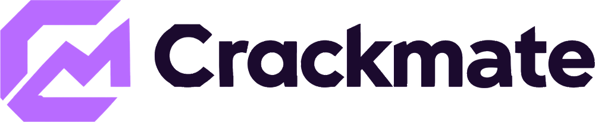
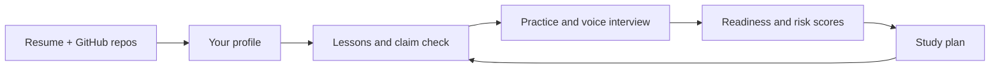

<p align="center">
  <picture>
    <source media="(prefers-color-scheme: dark)" srcset="web/public/brand/wordmark-dark.png">
    
  </picture>
</p>

<p align="center"><b>Your free, private AI interview coach.</b><br>
Turn your resume and real project code into lessons, mock interviews and a study plan.</p>

<p align="center">
  <a href="#-quick-start-pick-one-way"></a>
  <a href="#-api-keys-for-way-1-which-one-should-i-use"></a>
  <a href="#-features"></a>
  <a href="docs/reference.md"></a>
  <a href="https://github.com/deekshith-b48/Crackmate/issues"></a>
</p>

<p align="center">
  
  
  
  
  
  
  
</p>

---

## ✨ Why CrackMate

| 🆓 Free | 🔒 Private | 🎯 Honest |
|---|---|---|
| Runs on your computer. You bring a free Groq key. No paid plan, no local AI model. | Your resume and data never leave your machine, except the text you approve for the AI. | Answers cite their sources. Guesses are labelled. Scores are coaching estimates. |

> [!IMPORTANT]
> CrackMate is for **preparation and mock practice only**. Never use it during a real, live interview.

## 🧭 How it works



You prepare, practise, see your weak spots, then study exactly those. Repeat until ready.

## 🚀 Features

| | What it does |
|---|---|
| 📄 **Setup** | Read your resume, review it, and fix details *before* anything is sent to the AI. |
| 📚 **Learn** | Project deep-dives, skill lessons, 2-minute pitch, architecture diagrams, company DSA mode. |
| 🛡️ **Claim Checker** | Finds resume claims an interviewer will test, and checks them against your real code. |
| 🎤 **Practice** | Flip cards with spaced repetition, written feedback, and a spoken mock interview. |
| 🕸️ **Analyse** | Skill graph, interview-risk scores, hotspots in your code, engineering decisions from git history. |
| 🗓️ **Plan** | A time-boxed study plan that adapts to what you get wrong. |
| 💬 **Ask CrackMate** | Questions answered only from your own material, with numbered sources. |
| 🔌 **Claude and Codex** | Run as an MCP server: your own AI assistant does the writing, no API key. |
| 🧰 **Terminal** | Study from the command line. |

<details>
<summary><b>Also included</b></summary>

- Dark purple theme with a light option, works from phone to wide screens
- Shared lesson cache: one generated lesson serves every profile
- Automatic fallback to a second free AI provider when Groq is rate limited
- Secret scan of your repos (values are masked and never stored)
- Interview Brief: your pitches, top risks and key answers in one Markdown file
- Usage page showing AI calls and free-tier headroom

</details>

## ⚡ Quick start: pick one way

Both ways give you the same app, the same website and the same data. Pick the one that fits what you already have.

| | 🛠️ **Way 1: Manual** | 🔌 **Way 2: Claude or Codex** |
|---|---|---|
| **You need** | A free Groq key | A Claude or Codex subscription you already pay for |
| **Who writes the lessons** | A free AI service (Groq, with an optional Gemini backup) | Your own AI assistant |
| **API key** | Yes, free | None |
| **Where you work** | The CrackMate website | Chat with your assistant, plus the website |
| **Best for** | Anyone, no paid tools | People who use Claude Code, Claude Desktop or Codex daily |

You can do both: they share one database, so set up Way 1 first and add Way 2 later.

### 🛠️ Way 1: Manual (free, no Claude or Codex needed)

**You need:** Python 3.13, Node.js 20+, git, and a free [Groq key](https://console.groq.com/keys).

**1. Download**
```sh
git clone https://github.com/deekshith-b48/Crackmate.git
cd Crackmate
```

**2. Install**
```sh
python3.13 -m venv .venv
.venv/bin/python -m pip install -r requirements.txt -r requirements-api.txt
```

**3. Add your key** (saved in a file git ignores, so it is never uploaded)
```sh
mkdir -p .streamlit
printf 'GROQ_API_KEY = "paste-your-key-here"\n' > .streamlit/secrets.toml
```

**4. Run**
```sh
./run.sh
```

**5. Open** [http://127.0.0.1:8000](http://127.0.0.1:8000). The first run builds the interface (a few minutes). Press `Ctrl+C` to stop.

> [!TIP]
> New here? Go to **Setup**, add your resume, then **Learn → Projects**, attach a public GitHub repo, and generate your first lesson.

<details>
<summary><b>Step-by-step: your first session</b></summary>

1. **Setup:** upload a PDF or paste text. Review the extracted text. Nothing is sent until you press *Extract*.
2. **Learn → Projects:** paste a public GitHub URL for each project.
3. **Generate** a project lesson or a skill lesson.
4. **Claim Checker:** tick the claims you can defend out loud.
5. **Practice:** answer cards, get feedback, try the voice interview.
6. **Plan:** enter your interview time and build a study plan.
7. **Track:** watch readiness and risk change as you practise.

Update later with `git pull`, then `./run.sh`.

</details>

### 🔌 Way 2: With Claude or Codex (premium tools, no API key)

CrackMate runs as an **MCP server**. Your assistant then writes the lessons and scores your answers using **your own subscription**, and CrackMate stores everything locally. Works on macOS and Linux (on Windows, use WSL).

**Step 1. Get the code and let it set itself up** (once):

```sh
git clone https://github.com/deekshith-b48/Crackmate.git
cd Crackmate
./scripts/mcp.sh      # first run installs what it needs (about a minute). Press Ctrl+C when it waits.
```

**Step 2. Connect your assistant.** Use the full path to `scripts/mcp.sh` (run `pwd` inside the folder to see it).

<details open>
<summary><b>Claude Code</b></summary>

```sh
claude mcp add crackmate -- /full/path/to/Crackmate/scripts/mcp.sh
```

Or install it as a plugin (adds a coaching skill too):

```
/plugin marketplace add deekshith-b48/Crackmate
/plugin install crackmate@crackmate
```

Check with `/mcp`: `crackmate` should show as connected.

</details>

<details>
<summary><b>Claude Desktop</b></summary>

Open the config file, add the `mcpServers` block, then quit and reopen Claude Desktop.

- macOS: `~/Library/Application Support/Claude/claude_desktop_config.json`

```json
{
  "mcpServers": {
    "crackmate": { "command": "/full/path/to/Crackmate/scripts/mcp.sh" }
  }
}
```

If the file already has other settings, keep them and just add `mcpServers`.

</details>

<details>
<summary><b>Codex</b></summary>

```sh
codex mcp add crackmate -- /full/path/to/Crackmate/scripts/mcp.sh
```

Or add this to `~/.codex/config.toml`:

```toml
[mcp_servers.crackmate]
command = "/full/path/to/Crackmate/scripts/mcp.sh"
```

Optional, in your project's `AGENTS.md`:

```md
## CrackMate
Use the crackmate MCP tools for interview preparation. Preparation and mock practice only, never during a live interview.
Write lessons and scores yourself: call prepare_lesson / prepare_grading, follow `instructions` and `schema`, then call save_lesson / save_grading.
Never invent facts about the candidate's code. Ask one question at a time.
```

Codex support follows the same MCP standard, but we have not tested it in the Codex app yet.

</details>

**Step 3. Start talking.** For example:

> *Use CrackMate to prepare me for my interview. Here is my resume: …*

Your assistant creates your profile, reads your public GitHub repos, tells you what to study, teaches it and quizzes you.

**Step 4. See it on the website** (optional but recommended). Run `./run.sh` from the same folder and open [http://127.0.0.1:8000](http://127.0.0.1:8000). Profiles, lessons, scores and risks appear on every page, written by "your AI assistant".

<details>
<summary><b>Not working?</b></summary>

- **`crackmate` shows "connection closed" or does not appear:** run `./scripts/mcp.sh` in a terminal first and wait for the install to finish. Check the path in your config is the full path and has no typos. Restart the assistant.
- **Folder name has a space:** that is fine in the JSON and TOML above; just keep the path exactly as it is.
- **Website shows no profile:** the assistant and the website must use the same folder, so run `./run.sh` from the folder in your MCP config.
- **Quality:** a stronger assistant model writes better lessons and scores.

Full tool list and details: [docs/connect-ai-assistants.md](docs/connect-ai-assistants.md).

</details>

## 🔑 API keys for Way 1: which one should I use?

CrackMate needs an AI provider to write lessons and grade answers. It uses a **main** key (Groq) and an optional **backup** key (any other provider) that takes over automatically when the main one is busy.

### Our suggestion

| Your situation | Use this | Cost |
|---|---|---|
| **Just trying it, or a short prep** | Groq (main) + Google AI Studio (backup) | Free |
| **Preparing seriously for weeks** | Same free setup, plus a paid backup key if you keep hitting limits | Pay as you go |
| **You need the fastest, most reliable runs** | A paid plan on Groq, or a paid OpenAI-compatible provider as backup | Paid |

> [!TIP]
> **Best free setup:** Groq as the main key and Google AI Studio as the backup. Both give keys with no payment, and we tested this pairing.

### Free vs paid

| | 🆓 Free keys | 💳 Paid keys |
|---|---|---|
| **Good for** | Learning, one or two projects, a few lessons a day | Heavy daily use, "generate everything" runs, no waiting |
| **Limits** | Low per-minute and per-day token caps. You may see "wait about 1 minute". | Much higher limits, so far fewer waits |
| **Quality** | Same models as paid on Groq (`gpt-oss`) | Can use larger models |
| **Risk** | Limits change without notice | A bill, so set a spending cap in the provider's dashboard |

CrackMate never turns on billing for you. Whatever your key's plan allows is what you get.

### Providers at a glance

Limits and signup rules change often. Check each provider's page before you rely on them.

| Provider | Role | Free key? | Notes |
|---|---|---|---|
| [**Groq**](https://console.groq.com/keys) | Main (required) | Yes, no payment | Fast. Free tier is capped per minute and per day, shared by your whole Groq organization. Also does voice transcription. |
| [**Google AI Studio**](https://aistudio.google.com/apikey) (Gemini) | Backup | Yes, no payment | Works well as a backup. Some models get busy, so pick one that answers. |
| [OpenRouter](https://openrouter.ai/keys) | Backup | Limited | Free models have a small daily request cap. Fine only as an emergency backup. |
| [Cerebras](https://cloud.cerebras.ai) | Backup | Not for us | When we tried, signup asked for a payment. Fast and generous once paid. |
| [Mistral](https://console.mistral.ai) | Backup | Not for us | When we tried, a key needed a pay-as-you-go plan. |
| [OpenAI](https://platform.openai.com/api-keys) | Backup | No | Paid. Good quality, any OpenAI-compatible tool can use it. |

Only Groq and Google AI Studio have been tested with CrackMate. Others use the same standard, but are untested.

### How to add your keys (3 minutes)

1. **Create a Groq key** at [console.groq.com/keys](https://console.groq.com/keys). Copy it once; you cannot see it again.
2. **Create a backup key** (optional) at [aistudio.google.com/apikey](https://aistudio.google.com/apikey).
3. **Put both in one private file**, `.streamlit/secrets.toml`. Git ignores this file, so it is never uploaded:

   ```toml
   # Main key (required)
   GROQ_API_KEY = "paste-your-groq-key"

   # Optional: use a second quota on the same Groq key
   GROQ_FALLBACK_MODEL = "openai/gpt-oss-120b"

   # Optional: backup provider, used automatically when Groq is busy
   ALT_LLM_API_KEY  = "paste-your-backup-key"
   ALT_LLM_BASE_URL = "https://generativelanguage.googleapis.com/v1beta/openai/"
   ALT_LLM_MODEL    = "gemini-3.5-flash"
   ```

4. **Restart** CrackMate (`Ctrl+C`, then `./run.sh`).
5. **Check it worked:** the bottom of the sidebar shows a green dot and **Groq connected**.

<details>
<summary><b>Backup settings for other providers</b></summary>

Change the three `ALT_LLM_*` lines. Model names change, so pick one from the provider's model list.

| Provider | `ALT_LLM_BASE_URL` | Example `ALT_LLM_MODEL` |
|---|---|---|
| Google AI Studio | `https://generativelanguage.googleapis.com/v1beta/openai/` | `gemini-3.5-flash` |
| OpenRouter | `https://openrouter.ai/api/v1` | a model ending in `:free` |
| Cerebras | `https://api.cerebras.ai/v1` | `gpt-oss-120b` |
| Mistral | `https://api.mistral.ai/v1` | `mistral-small-latest` |
| OpenAI | `https://api.openai.com/v1` | `gpt-4o-mini` |

Prefer environment variables? Copy `.env.example` to `.env` and fill the same names.

</details>

<details>
<summary><b>Seeing errors?</b></summary>

- **"wait about 1 minute" or rate limit:** you hit the free cap. Wait, or add a backup key.
- **"model unavailable":** the model name is wrong or retired. Pick a current one from the provider.
- **"rejected access":** the key is wrong or revoked. Create a new one.
- **Voice not working:** voice always uses your Groq key.

</details>

> [!WARNING]
> Treat keys like passwords. Never paste them into chats, issues or commits. If one leaks, delete it in the provider's dashboard and create a new one.

## 🐳 Run with Docker

Prefer not to install Python and Node? Use the ready-made image from GitHub Packages:

```sh
docker run --rm -p 127.0.0.1:8000:8000 \
  -e GROQ_API_KEY="paste-your-key" \
  -v crackmate-data:/app/.crackmate \
  ghcr.io/deekshith-b48/crackmate:latest
```

Then open [http://127.0.0.1:8000](http://127.0.0.1:8000). Your data is kept in the `crackmate-data` volume. Add `-e ALT_LLM_API_KEY=... -e ALT_LLM_BASE_URL=... -e ALT_LLM_MODEL=...` for a backup provider. Keep `127.0.0.1:` in the port flag so only your own computer can reach the app.

## 🧰 Terminal

```sh
./crackmate_cli next     # the one best thing to study right now
./crackmate_cli risk     # your top interview-risk topics
./crackmate_cli quiz     # flashcards in the terminal
./crackmate_cli brief -o brief.md
```

Full command list in [docs/reference.md](docs/reference.md).

## 🔒 Your data stays yours

- Your resume, profile and progress live in `.crackmate/` on your machine.
- Your keys live in `.streamlit/secrets.toml` only.
- Both are in `.gitignore`, along with `.env`, PDFs and Word files, so they cannot be committed by mistake.
- The app listens on `127.0.0.1` only and never sends your key to the browser.

> [!WARNING]
> Never paste API keys into chats, issues or commits. If you do, delete the key and create a new one.

## 🗂️ Project layout

```text
core/       engine: AI calls, lessons, spaced repetition, career intelligence, search
api/        FastAPI backend (local only, streamed generation)
web/        Next.js interface (responsive, dark and light)
crackmate/  command line and MCP server
ui/         original Streamlit interface (still works)
prompts/    prompt templates
tests/      Python tests (146)
docs/       detailed reference
```

## 🧪 Development

```sh
.venv/bin/python -m unittest discover -s tests   # Python tests
cd web && npm test                               # web tests
```

Run the API and web app separately for live reload: `.venv/bin/python -m uvicorn api.main:app --port 8000` and, in `web/`, `npm run dev`.

## 🤝 Contributing

Issues and pull requests are welcome. Please keep it free to run, keep private data out of the repo, and add a test with your change.

## 📄 License

[MIT](LICENSE). Third-party dependencies keep their own licenses. Any bundled or imported learning content must be used under its own license and credited.

<p align="center"><sub>Built for candidates who want to practise, not cheat. Good luck with your interview.</sub></p>
