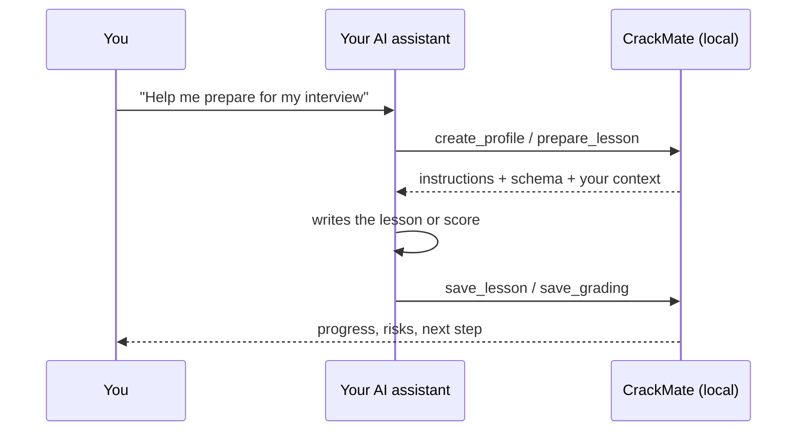

# Use CrackMate inside Claude, Codex or any MCP assistant

CrackMate can run as an **MCP server**. Your AI assistant then does the writing and scoring with **your own subscription**, and CrackMate stores your profile, lessons and progress on your computer.

**No API key. No third-party service. Nothing to pay for beyond the assistant you already use.**

## How it works



CrackMate checks everything the assistant sends against a strict schema before saving it, and labels it as written by your assistant.

## Set up (once)

```sh
git clone https://github.com/deekshith-b48/Crackmate-.git
cd Crackmate-
./scripts/mcp.sh      # first run installs what it needs, then waits; press Ctrl+C
```

Then add it to your assistant:

### Claude Code

Option A, plugin (adds the coaching skill too):

```
/plugin marketplace add deekshith-b48/Crackmate-
/plugin install crackmate@crackmate
```

Option B, just the tools:

```sh
claude mcp add crackmate -- /full/path/to/Crackmate-/scripts/mcp.sh
```

### Codex

```sh
codex mcp add crackmate -- /full/path/to/Crackmate-/scripts/mcp.sh
```

or add to `~/.codex/config.toml`:

```toml
[mcp_servers.crackmate]
command = "/full/path/to/Crackmate-/scripts/mcp.sh"
```

Optional: put the coaching rules in your project's `AGENTS.md`:

```md
## CrackMate
Use the crackmate MCP tools for interview preparation. Preparation and mock practice only, never during a live interview.
You write lessons and scores yourself: call prepare_lesson / prepare_grading, follow `instructions` and `schema`, then call save_lesson / save_grading.
Never invent facts about the candidate's code. Ask one question at a time.
```

### Claude Desktop and other MCP apps

Add this to the app's MCP settings file (for Claude Desktop: `claude_desktop_config.json`):

```json
{ "mcpServers": { "crackmate": { "command": "/full/path/to/Crackmate-/scripts/mcp.sh" } } }
```

Restart the app after editing.

## Your first chat

Try: *"Use CrackMate to prepare me for a backend interview. Here is my resume: ..."*

The assistant will create your profile, read your GitHub repos, tell you what to study, teach it, and quiz you.

## Tools

| Tool | What it does |
|---|---|
| `create_profile` / `save_profile` | Build your profile from resume text (the assistant extracts it) |
| `attach_repo` | Read a public GitHub repo: stack, what you wrote, hotspots (no AI needed) |
| `get_study_next`, `get_weak_spots`, `get_overview` | What to study, top risks, progress |
| `get_lesson` | Open a saved lesson |
| `prepare_lesson` / `save_lesson` | The assistant writes a lesson (skill, project, claims, pitch or diagram) |
| `quiz_me` | Practice questions |
| `prepare_grading` / `save_grading` | The assistant scores your answer; it counts toward readiness |
| `search_knowledge` | Search your resume, repos and lessons, with sources |
| `get_interview_brief`, `get_project_architecture`, `get_profile` | Summaries |
| `grade_answer` | Optional shortcut that uses a Groq key instead of your assistant |

## Good to know

- **Your data:** installed as a Claude plugin, data is kept in `~/.crackmate/`, so updates never erase it. Run from a clone, it uses the clone's `.crackmate/`.
- **Quality depends on your assistant.** A stronger model writes better lessons and scores.
- **Honesty:** scores are coaching estimates. Lessons written by your assistant show "host" as their source in the web app.
- **Not tested with Codex yet.** The Claude path is tested through the MCP protocol; Codex uses the same standard.
- Preparation and mock practice only, never during a real interview.
